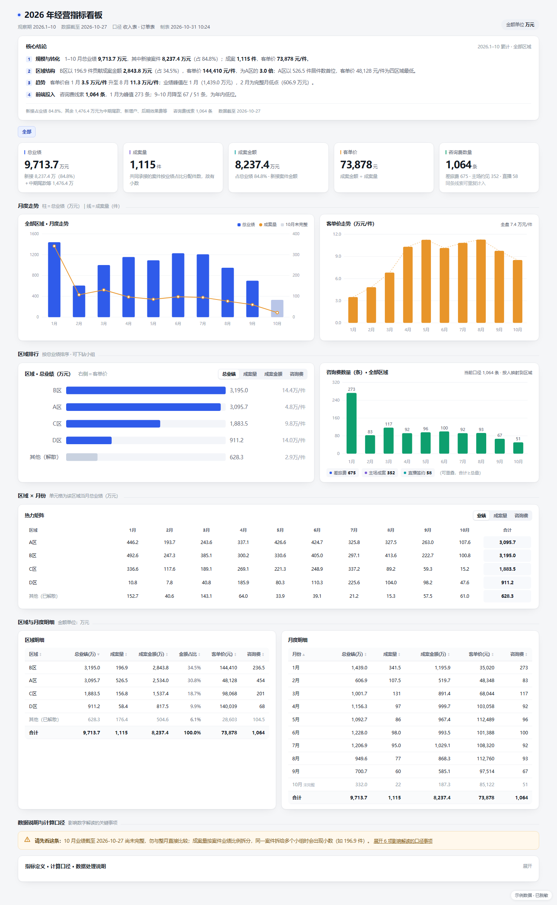
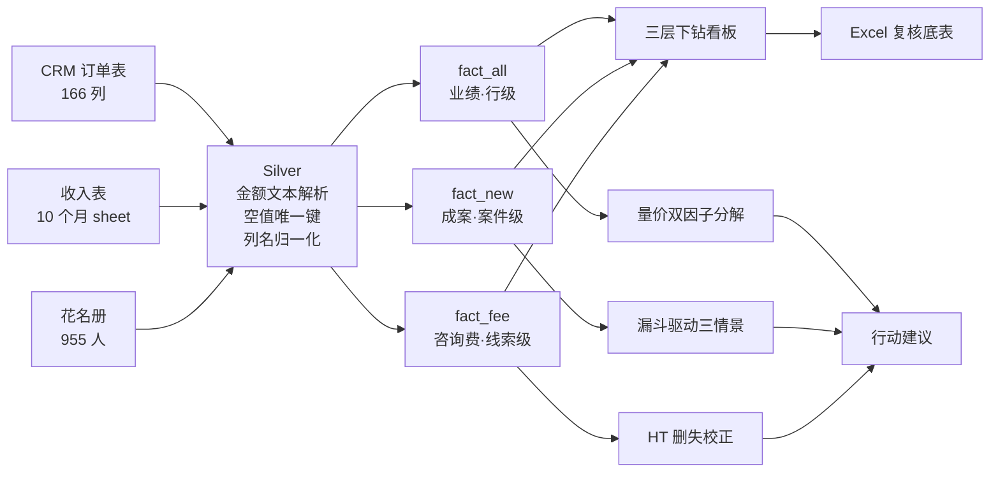

# 律所经营分析：从 CRM 导出到可决策的指标体系

> 一家区域性律所 2026 年业绩下滑，四张手工导出的 Excel、四种互相矛盾的"业绩"口径。
> 这个仓库是把它做成**一套能对账的指标体系 + 归因 + 预测 + 自动监测**的全过程。

<p>


</p>



---

## English summary

A regional law firm's revenue fell sharply in 2026, and four hand-exported Excel files produced four
contradictory definitions of "revenue". This project turns them into one auditable metric system:

- **Metric governance** — a dictionary that survived 5 revisions (a split-attribution rule was corrected
  twice because the validation baseline was wrong), with every drill-down table reconciling to the total.
- **Attribution** — a two-factor decomposition (volume × price per meeting) that explains the -3.22M CNY
  decline with **zero residual**; the drop is 100% volume, not price.
- **Forecasting** — Horvitz–Thompson censoring correction for the incomplete current month (raw 30.2% →
  corrected 47.1–64.3%), then a funnel-driven 3-scenario model for 2026-11 ~ 2027-03.
- **Delivery** — six single-file HTML dashboards (no CDN, offline, double-click to open) plus an Excel
  workbook of 13 auditable sheets, driven by a 3.2k-line codebase (~550 lines of ETL, ~680 lines of
  monitor) and a scheduled daily refresh.

All regional and firm identifiers are **anonymized** (`A/B/C/D 区`); no raw data is included.

---

## 一句话结论

七个字：**跌的全是"量"，单价反而在涨。**

| | 数字 | 说明 |
|---|---|---|
| 合同额降幅（3→9 月） | **-322.2 万** | 量效应 -372.1 / 价效应 +49.8，分解无残差 |
| 客场贡献占比 | **74%** | 降幅主力，主场 26% |
| 公海线索入库 | **-77.0%** | 21,057 → 4,847，但线索→约见效率**提升** |
| 2027Q1 三情景极差 | **2.2 倍** | 570 / 876 / 1,254 万，真正的决策点 |

---

## 目录结构

```
.
├── dashboards/          成品看板（单文件 HTML，双击即开；已脱敏）
│   ├── 01_经营指标看板.html         727 KB  全所经营指标 + 三层下钻 + 数据说明
│   ├── 02_业绩下滑归因.html          43 KB  量价分解 / 瀑布校验 / 排除项 / 监测阈值
│   ├── 03_成交率预测.html            69 KB  删失校正 + 三模型混合 + 回测
│   ├── 04_业绩预测三情景.html        48 KB  漏斗驱动 + 敏感性 + 2027Q1
│   ├── 05_支付能力与客单价.html      58 KB  付款条件 × 客单价 × 回款
│   └── monitor.html                  54 KB  自动化监测仪表盘（含 data.js 热更新）
├── docs/                方法与口径（本仓库的核心）
│   ├── 01-business-context.md   业务模式与问题定义
│   ├── 02-data-pipeline.md      三层链路、连接键、脚本映射
│   ├── 03-metric-dictionary.md  ★ 指标口径字典 + 口径演进史
│   ├── 04-methods.md            双因子分解 / 删失校正 / 三情景 / 阈值设计
│   ├── 05-data-quality.md       ★ 13 个会改变结论的数据陷阱
│   └── 06-findings.md           结论、行动建议、以及"回答不了的"
├── src/
│   ├── etl/build_gold.py        原始表 → 三张事实表（金额按行、件数按比例拆）
│   ├── render.py                payload + 模板 → 单文件看板
│   ├── excel/build_workbook.py  payload → 13 sheet 复核底表
│   ├── analysis/                归因 / 删失校正 / 三情景 / 支付能力 / 区域专项
│   └── monitor/monitor_etl.py   每日自动刷新的监测仪表盘
├── tools/               脱敏与截图（可复现，非手工改文件）
├── data/                字段说明；原始数据不入仓
└── images/              看板截图
```

---

## 分析链条



---

## 三个值得单独说的技术点

### 1. 撞单：一次被推翻的口径

同一案件被两个小组共接，收入表拆成多行都标「撞单」。按"取单笔最大值"去重，总业绩变成 7,130 万；按"全部求和"，是 9,713 万。差 2,583 万。

第一版用了订单表的「首期认款金额」做校验，得到"完全吻合"——**这是假象**：首期通常只是合同额的一半，拆分后每组各记一份首期，取最大值恰好等于首期。
换「合同总金额」做锚点后立刻分开：求和一致率 56.8%，取最大值一致率只剩 0.6%。

> **跨表校验时，校验基准必须与被校验指标同义、同粒度。用「首期」校「全额」，得到的"完美吻合"最危险。**

### 2. 月末的成交率，不能直接算

10 月原始成交率 30.2%，但每场约见的观察窗口 0–27 天不等——混算必然低估。
用 2–8 月拟合成交延迟分布 F(t)（当天 28.2% / 7 天 61.6% / 30 天 100%），再做 Horvitz–Thompson 型删失校正解不动点，得 47.1%；换录入滞后假设得 56.6%；非参数条件率 64.3%。
三模型混合后中心 56%，**只报 `P(<65%) = 77.2%`，不报单一概率**——因为单模型 96.7% 只在"节奏不变"这一个假设下成立。

### 3. 件数要拆，但不能重复计

金额可以按业绩比例分给多个小组，件数不行。所以：**金额按行、件数按业绩比例拆**，使区域件数之和恰好 = 1,115。
财务给的参考公式在边界上不自洽（43 个案件会算 2 件，2 个案件会丢），修正为"每案恰 1 件"并验证了恒等式。代价是区域件数出现小数（196.9 件），已在看板脚注直接说明。

更多见 [docs/03](docs/03-metric-dictionary.md) 与 [docs/05](docs/05-data-quality.md)。

---

## 交付物

| 产物 | 形态 | 为什么这样交付 |
|---|---|---|
| 经营指标看板 | 单文件 HTML 727 KB | 受众电脑上没有 Python/BI 账号，双击即开、可微信发送、断网可看 |
| 业绩下滑归因 | 单文件 HTML 43 KB | 瀑布图 + 排除项表格，让"不是这个原因"也可见 |
| 成交率预测 | 单文件 HTML 69 KB | 三个估计并排展示，不藏不确定性 |
| 三情景预测 | 单文件 HTML 48 KB | 参数可改，敏感性直接标在图上 |
| 支付能力分析 | 单文件 HTML 58 KB | 客单价与首付比双轴，讲清"涨价靠放账期" |
| 复核底表 | Excel 13 sheet | 每张表可回溯到看板某一块，供财务复核 |
| 监测仪表盘 | HTML + data.js | 工作日 10:00/10:20/…/17:00 六个时点自动刷新，当月指标做删失校正，避免"每月初必红" |

图形全部手写 SVG，不引第三方图表库：断网可用，且能精确控制标注位置（图内百分比标签跟着折线走会重叠，这类问题只有自己画才修得掉）。

---

## 快速开始

```bash
# 依赖只有 3 个
pip install pandas numpy openpyxl

# 1. 把 CRM 导出的 4 个 xlsx 放进 data/raw/（文件名见 data/README.md）
# 2. 构建事实表 → 渲染看板 → 生成底表
python src/etl/build_gold.py
python src/render.py
python src/excel/build_workbook.py

# 3. 归因 / 预测 / 支付能力
python src/analysis/attribution.py
python src/analysis/censoring_forecast.py
python src/analysis/revenue_scenarios.py
python src/analysis/payment_capacity.py
python src/render.py attribution censoring scenarios payment

# 4. 监测仪表盘（--force 忽略指纹缓存）
python src/monitor/monitor_etl.py --force
```

区域代号默认 `A区,B区,C区,D区`，可用环境变量覆盖：`REGIONS="你的区域1,你的区域2" python src/etl/build_gold.py`。

---

## 数据说明与脱敏

- **不含任何原始数据**。`data/raw/` 已在 `.gitignore` 中，仓库只保留字段说明与接入格式。
- **已脱敏**：区域 → `A/B/C/D 区`（字母与规模无关），机构名 → `某律所`，人员一律不出现。
  脱敏由 `tools/anonymize.py` 统一批处理（映射表 + 一致性检查），不是手工改文件——这样"代码里的区域代号"和"页面上的区域代号"保证严格一致。
- 页面右下角有「示例数据·已脱敏」标记；金额保留，因为金额是这套方法的证据，而机构身份才是敏感项。
- 若要用真实数据复跑，改 `REGIONS` 即可；模板里的区域标签同步替换（或干脆沿用代号出图）。

## 局限

1. **缺花费数据**：CRM 有来源、广告账号、广告计划，但没有投放消耗。所以"约见下降是主动砍投还是被动掉量"**无法判定**——这是唯一能定性归因的缺口。
2. **退费无原因字段**，只有金额。
3. **无成本分摊**，算不出单案毛利。
4. 月度数据下，约见对次月业绩的滞后相关为 **-0.638（负）**，说明月度只能做同期诊断，要预警必须降到周粒度。

## 参考

仓库结构与 README 叙述框架参考了以下公开项目（**只学组织方式，不用其数据与结论**）：

- [`PriyankaJhaTheDeveloper/DataAnalystPortfolioProjects`](https://github.com/PriyankaJhaTheDeveloper/DataAnalystPortfolioProjects) — 目录分层与"业务问题 → 方法 → 结论"的叙事
- [`Jing-yilin/openlaw_analysis`](https://github.com/Jing-yilin/openlaw_analysis) — 法律数据"采集 → 存储 → 分析 → 可视化"的链条组织
- [`AnkitSaini491/HR-Analytics-Dashboard-`](https://github.com/AnkitSaini491/HR-Analytics-Dashboard-) — KPI 卡与分组布局

## License

MIT
